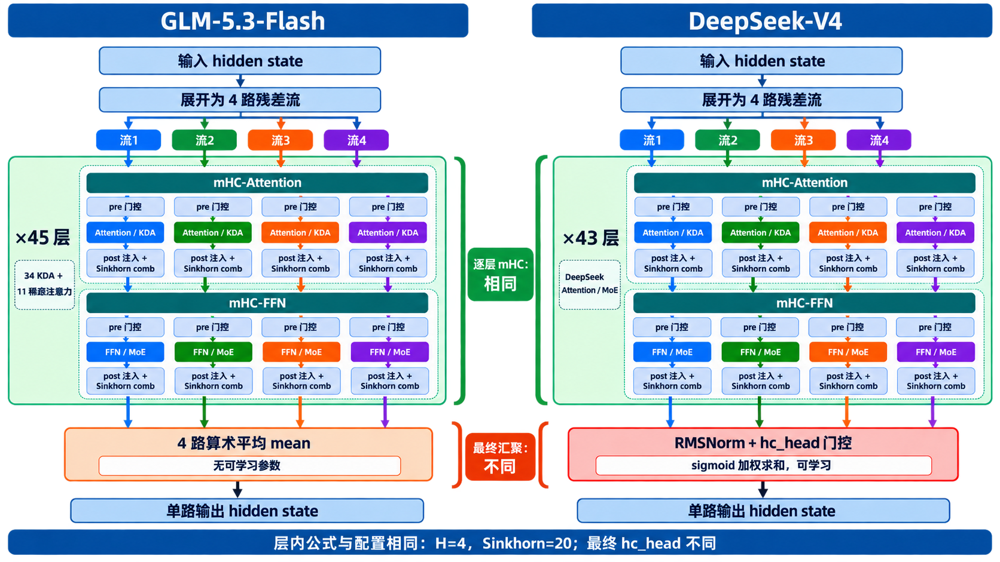

<!--
Copyright 2026 The xLLM Authors. All Rights Reserved.

Licensed under the Apache License, Version 2.0 (the "License");
you may not use this file except in compliance with the License.
You may obtain a copy of the License at

    http://www.apache.org/licenses/LICENSE-2.0

Unless required by applicable law or agreed to in writing, software
distributed under the License is distributed on an "AS IS" BASIS,
WITHOUT WARRANTIES OR CONDITIONS OF ANY KIND, either express or implied.
See the License for the specific language governing permissions and
limitations under the License.
-->

# GLM-5.3-Flash mHC 机制详解

> 调研日期：2026-09-03  
> 适用对象：GLM-5.3-Flash 主文本模型  
> 源码基线：Hugging Face Transformers `ac3244569528944b9d5773cafea525cd8a8b63de`  
> 模型配置基线：GLM-5.3-Flash `03eb5366286afd40d2221b1d9c63a6dd1ba4832e`

## 1. 结论摘要

GLM-5.3-Flash 使用 mHC（Manifold-Constrained Hyper-Connections，流形约束超连接）替代传统单路残差连接。核心特征如下：

1. Embedding 输出从一路复制成 `H=4` 路残差流。
2. 4 路残差流以 `[B, S, 4, 4096]` 的形状贯穿全部 45 个 Decoder Layer。
3. 每个 Decoder Layer 有两个相互独立的 mHC 站点：`attn_hc` 和 `ffn_hc`，因此主干共有 `45 × 2 = 90` 个 mHC 站点。
4. 每个站点根据当前 token 的 4 路状态动态生成：
   - `pre [B,S,4]`：将 4 路读成一路，供 Attention/KDA 或 FFN 使用；
   - `post [B,S,4]`：将子层的一路输出分别写回 4 路；
   - `comb [B,S,4,4]`：在 4 路旧残差之间做动态混合，即论文中的残差映射 `H_res`。
5. `comb` 经 20 次 Sinkhorn 行列归一化，成为近似双随机矩阵，限制深层复合残差映射的信号放大。
6. 跑完第 44 层后，张量仍为 `[B,S,4,4096]`；GLM 使用 `mean(dim=2)` 将 4 路等权平均成 `[B,S,4096]`，再执行最终 RMSNorm。

最容易混淆的一点是：**`fn/base/scale` 是模型保存和训练的静态参数；`pre/post/comb` 是这些参数根据当前 hidden state 动态生成的中间权重。**



## 2. mHC 解决什么问题

### 2.1 普通残差连接

普通 Pre-Norm Transformer 的一个子层可以写成：

$$
x_{l+1}=x_l+F(\operatorname{Norm}(x_l)).
$$

这里只有一路残差状态 `x_l ∈ R^D`。恒等路径允许浅层信号直接传播到深层，是深网络稳定训练的重要基础。

### 2.2 Hyper-Connections：把一路扩成多路

HC 将残差状态扩展成 `H` 路：

$$
X_l=
\begin{bmatrix}
x_{l,1}\\
\vdots\\
x_{l,H}
\end{bmatrix}
\in\mathbb{R}^{H\times D}.
$$

它引入三种映射：

$$
H_l^{\mathrm{pre}}\in\mathbb{R}^{1\times H},\qquad
H_l^{\mathrm{post}}\in\mathbb{R}^{1\times H},\qquad
H_l^{\mathrm{res}}\in\mathbb{R}^{H\times H}.
$$

单个子层的传播形式是：

$$
X_{l+1}
=
H_l^{\mathrm{res}}X_l
+
H_l^{\mathrm{post}\,\top}
F(H_l^{\mathrm{pre}}X_l).
$$

这样可以在不把 Attention/FFN 的输入维度扩大为 `H×D` 的情况下，提高残差拓扑的容量。不过，不受约束的 `H_res` 在深层反复相乘时可能放大或衰减信号。

### 2.3 mHC：约束残差混合矩阵

mHC 将 `H_res` 投影到 Birkhoff polytope，即近似双随机矩阵集合：

$$
H^{\mathrm{res}}\ge 0,\qquad
H^{\mathrm{res}}\mathbf{1}=\mathbf{1},\qquad
\mathbf{1}^{\top}H^{\mathrm{res}}=\mathbf{1}^{\top}.
$$

因此每一行和每一列都近似求和为 1。双随机矩阵对乘法封闭，多层 `H_res` 的复合映射仍保持该性质；这正是 mHC 用来改善深层信号与梯度传播稳定性的核心约束。原论文给出了完整动机、公式和 Sinkhorn 投影方法：[mHC 论文，第 3～4 节](https://arxiv.org/html/2512.24880#S4)。

## 3. GLM-5.3-Flash 中的整体位置

GLM-5.3-Flash 的主文本模型配置为：

| 配置 | 值 | 含义 |
|---|---:|---|
| `num_hidden_layers` | 45 | 主干 Decoder Layer 数量 |
| `hidden_size` | 4096 | 单路 hidden dimension，记为 `D` |
| `hc_mult` | 4 | 残差流数量，记为 `H` |
| `hc_sinkhorn_iters` | 20 | Sinkhorn 迭代次数 |
| `hc_eps` | `1e-6` | 正值与归一化稳定项 |

配置来源：[GLM-5.3-Flash 官方 `config.json`](https://huggingface.co/zai-org/GLM-5.3-Flash/blob/03eb5366286afd40d2221b1d9c63a6dd1ba4832e/config.json)。

整体数据流为：

```text
token ids
   │
   ▼
Embedding                            [B,S,4096]
   │ unsqueeze(2) + expand(H=4)
   ▼
初始 4 路残差流 X⁽⁰⁾               [B,S,4,4096]
   │
   ├─ Decoder Layer 0
   │    ├─ attn_hc → Attention/KDA → post+comb 更新
   │    └─ ffn_hc  → FFN/MoE       → post+comb 更新
   ├─ Decoder Layer 1
   │    └─ ...
   ├─ ...
   └─ Decoder Layer 44
        └─ 输出 X⁽⁴⁵⁾              [B,S,4,4096]
   │
   ▼
hc_head: mean(dim=2)                 [B,S,4096]
   │
   ▼
Final RMSNorm                        [B,S,4096]
   │
   ▼
LM Head / logits                     [B,S,vocab_size]
```

Embedding 展开、45 层循环和最终汇聚的直接实现见 [GLM 模型 `forward`](https://github.com/huggingface/transformers/blob/ac3244569528944b9d5773cafea525cd8a8b63de/src/transformers/models/glm5_next/modular_glm5_next.py#L1163-L1241)。

### 3.1 初始 4 路是否不同

初始展开使用：

```python
hidden_states = inputs_embeds.unsqueeze(2).expand(-1, -1, hc_mult, -1).contiguous()
```

因此一开始：

$$
x_{0,1}=x_{0,2}=x_{0,3}=x_{0,4}=\operatorname{Embedding}(token).
$$

初始 4 路是相同副本。进入第一个 mHC 站点后，`post` 可以给子层输出分配不同注入强度，4 路状态由此开始分化；之后 `comb` 又持续在各路之间交换信息。

## 4. 记号与张量维度

本文使用：

| 符号 | 含义 | GLM-5.3-Flash 中的值 |
|---|---|---:|
| `B` | batch size | 运行时决定 |
| `S` | 当前 query sequence length | Prefill 通常大于 1；Decode 通常为 1 |
| `H` | mHC 残差流数量 | 4 |
| `D` | 单路 hidden size | 4096 |
| `M` | mHC generator 输出宽度 | `(2+H)H=24` |

一个 mHC 站点中的主要张量为：

| 张量 | 通用形状 | GLM 具体形状 |
|---|---:|---:|
| `hidden_streams` | `[B,S,H,D]` | `[B,S,4,4096]` |
| `flat` | `[B,S,H×D]` | `[B,S,16384]` |
| `fn` | `[H²+2H,H×D]` | `[24,16384]` |
| `base` | `[H²+2H]` | `[24]` |
| `scale` | `[3]` | `[3]` |
| `mix_logits` | `[B,S,H²+2H]` | `[B,S,24]` |
| `pre` | `[B,S,H]` | `[B,S,4]` |
| `post` | `[B,S,H]` | `[B,S,4]` |
| `comb` | `[B,S,H,H]` | `[B,S,4,4]` |
| `collapsed` | `[B,S,D]` | `[B,S,4096]` |
| 子层输出 | `[B,S,D]` | `[B,S,4096]` |
| 更新后的 4 路状态 | `[B,S,H,D]` | `[B,S,4,4096]` |

## 5. `pre`、`post` 和 `comb` 的生成过程

GLM 的 `Glm5NextTextHyperConnection` 直接继承 `DeepseekV4HyperConnection`，没有覆盖计算逻辑：[GLM HyperConnection 定义](https://github.com/huggingface/transformers/blob/ac3244569528944b9d5773cafea525cd8a8b63de/src/transformers/models/glm5_next/modular_glm5_next.py#L337-L344)。

### 5.1 展平与无权重 RMSNorm

输入：

```text
hidden_streams: [B,S,4,4096]
```

先将残差流维和 hidden 维拼起来：

```text
flat: [B,S,4×4096] = [B,S,16384]
```

然后对最后一维执行无可学习权重的 RMSNorm：

$$
\hat{x}=\frac{x}{\sqrt{\operatorname{mean}(x^2)+\epsilon}}.
$$

展平后再归一化意味着生成器能够同时观察当前 token 的全部 4 路状态，而不是每路独立地产生系数。

### 5.2 一个 Linear 同时产生三类 logits

Transformers 实现将论文中的三个投影合并成一个参数 `fn`：

```python
mix_logits = F.linear(flat, fn)
```

形状为：

```text
[B,S,16384] × fn[24,16384]ᵀ → [B,S,24]
```

再拆分：

```python
pre_w, post_w, comb_w = mix_logits.split([4, 4, 16], dim=-1)
```

得到：

```text
pre_w : [B,S,4]
post_w: [B,S,4]
comb_w: [B,S,16] → view → [B,S,4,4]
```

因此模型中没有三个名为 `W_pre`、`W_post`、`W_res` 的大参数矩阵；三种动态映射由同一个合并 Linear 生成。

### 5.3 `pre`：读出 4 路

$$
pre=\sigma(pre_w\cdot scale_0+base_{pre})+\epsilon.
$$

形状：

```text
pre: [B,S,4]
```

对每个 `(batch, token)`，它都是 4 个正权重：

$$
pre=[p_1,p_2,p_3,p_4].
$$

它把 4 路压成子层输入：

$$
z=\sum_{j=1}^{4}p_jx_j,
$$

对应维度：

```text
pre.unsqueeze(-1): [B,S,4,1]
hidden_streams    : [B,S,4,4096]
sum(dim=2)        : [B,S,4096]
```

`pre` 经过 sigmoid，但没有 softmax，因此四个权重不要求和为 1。

### 5.4 `post`：将子层输出写入 4 路

$$
post=2\sigma(post_w\cdot scale_1+base_{post}).
$$

形状：

```text
post: [B,S,4]
```

每个分量范围在 `(0,2)`。若子层输出为：

```text
u = F(Norm(z)): [B,S,4096]
```

则写回项为：

```text
post.unsqueeze(-1): [B,S,4,1]
u.unsqueeze(-2)   : [B,S,1,4096]
乘积               : [B,S,4,4096]
```

即每一路收到同一个子层输出 `u`，但注入强度 `post_k` 可以不同。

### 5.5 `comb`：混合旧的 4 路残差

先得到动态 logits：

$$
L_{res}=\operatorname{reshape}(comb_w)\cdot scale_2+base_{res},
$$

其中：

```text
L_res: [B,S,4,4]
```

Transformers 实现先沿最后一维 softmax 并加 `eps`，然后交替做列归一化和行归一化：

```python
comb = softmax(comb_logits, dim=-1) + eps
comb = comb / (comb.sum(dim=-2, keepdim=True) + eps)
for _ in range(sinkhorn_iters - 1):
    comb = comb / (comb.sum(dim=-1, keepdim=True) + eps)
    comb = comb / (comb.sum(dim=-2, keepdim=True) + eps)
```

最终：

```text
comb: [B,S,4,4]
```

对于一个 token，可以写成：

$$
C=
\begin{bmatrix}
c_{11}&c_{12}&c_{13}&c_{14}\\
c_{21}&c_{22}&c_{23}&c_{24}\\
c_{31}&c_{32}&c_{33}&c_{34}\\
c_{41}&c_{42}&c_{43}&c_{44}
\end{bmatrix}.
$$

经过有限次 Sinkhorn 后：

$$
\sum_jc_{ij}\approx1,\qquad
\sum_ic_{ij}\approx1,\qquad c_{ij}>0.
$$

原论文选择 20 次迭代作为实践值；GLM 配置同样使用 20 次。[mHC 参数化与 Sinkhorn](https://arxiv.org/html/2512.24880#S4.SS2)

三类权重的完整源码见 [DeepSeek-V4 HyperConnection `forward`](https://github.com/huggingface/transformers/blob/ac3244569528944b9d5773cafea525cd8a8b63de/src/transformers/models/deepseek_v4/modular_deepseek_v4.py#L695-L766)。

## 6. 一个 mHC 站点如何更新 4 路状态

设进入站点的 4 路状态为：

$$
X=
\begin{bmatrix}
x_1\\x_2\\x_3\\x_4
\end{bmatrix}
\in\mathbb{R}^{4\times4096}.
$$

### 6.1 Read：4 路压成 1 路

$$
z=pre\cdot X=\sum_{j=1}^{4}pre_jx_j
\in\mathbb{R}^{4096}.
$$

### 6.2 Compute：一路进入实际子层

$$
u=F(\operatorname{Norm}(z))
\in\mathbb{R}^{4096}.
$$

`F` 可以是该层的 KDA、稀疏 Attention 或 FFN/MoE。mHC 并不把实际子层的输入宽度扩大 4 倍；子层仍处理一路 `4096` 维状态。

### 6.3 Mix and Write：混合旧流并注入新结果

代码的更新方向是：

$$
X'=C^{\top}X+post^{\top}u.
$$

第 `k` 路展开为：

$$
x'_k=
\sum_{j=1}^{4}C_{j,k}x_j
+post_ku.
$$

维度推导：

```text
Cᵀ                         [B,S,4,4]
X                          [B,S,4,4096]
Cᵀ @ X                     [B,S,4,4096]

post.unsqueeze(-1)         [B,S,4,1]
u.unsqueeze(-2)            [B,S,1,4096]
post × u                    [B,S,4,4096]

两项相加后的 X'            [B,S,4,4096]
```

注意 `C` 经 Sinkhorn 后通常不是对称矩阵，因此 `C @ X` 与 `Cᵀ @ X` 不等价。Transformers 明确使用：

```python
torch.matmul(comb.transpose(-1, -2), residual)
```

GLM 的实际更新代码见 [Decoder Layer `forward`](https://github.com/huggingface/transformers/blob/ac3244569528944b9d5773cafea525cd8a8b63de/src/transformers/models/glm5_next/modular_glm5_next.py#L1042-L1091)。

## 7. 一个完整 Decoder Layer 的两次更新

第 `l` 个 Decoder Layer 的输入记为：

$$
X^{(l)}\in\mathbb{R}^{B\times S\times4\times4096}.
$$

### 7.1 Attention/KDA 站点

根据 `X^(l)` 动态生成：

$$
(p_l^A,q_l^A,C_l^A)=HC_l^A(X^{(l)}).
$$

压成一路并执行 Attention/KDA：

$$
z_l^A=\sum_jp_{l,j}^Ax_{l,j},
$$

$$
a_l=Attention_l(\operatorname{Norm}(z_l^A)).
$$

更新 4 路：

$$
\widetilde{x}_{l,k}
=q_{l,k}^Aa_l
+\sum_jC_{l,j,k}^Ax_{l,j}.
$$

输出：

```text
X̃^(l): [B,S,4,4096]
```

### 7.2 FFN/MoE 站点

`ffn_hc` 不复用 Attention 站点的权重，而是根据新的 `X̃^(l)` 重新生成：

$$
(p_l^F,q_l^F,C_l^F)=HC_l^F(\widetilde{X}^{(l)}).
$$

然后：

$$
z_l^F=\sum_jp_{l,j}^F\widetilde{x}_{l,j},
$$

$$
f_l=FFN_l(\operatorname{Norm}(z_l^F)),
$$

$$
x_{l+1,k}
=q_{l,k}^Ff_l
+\sum_jC_{l,j,k}^F\widetilde{x}_{l,j}.
$$

该层最终输出：

```text
X^(l+1): [B,S,4,4096]
```

所以每个 Decoder Layer 对 4 路状态更新两次，形状始终不变。

## 8. 4 路状态如何贯穿 45 层

完整生命周期为：

$$
X^{(0)}
\xrightarrow{HC_0^A,F_0^A}
\widetilde X^{(0)}
\xrightarrow{HC_0^F,F_0^F}
X^{(1)}
\rightarrow\cdots\rightarrow
X^{(45)}.
$$

其中：

```text
X⁽⁰⁾  : [B,S,4,4096]
X⁽¹⁾  : [B,S,4,4096]
...
X⁽⁴⁵⁾: [B,S,4,4096]
```

需要强调：

- `pre/post/comb` 不会从第 0 层原样传到第 1 层；它们是每个站点的临时结果。
- 每层 Attention 和 FFN 都有自己的 `fn/base/scale` 参数。
- 每个 token 都会得到自己的 `pre/post/comb`。
- 真正跨层传播的是更新后的 4 路 `hidden_states`。

## 9. 静态参数与动态权重

### 9.1 静态可学习参数

一个 mHC 站点持有：

```text
fn   : [24,16384]
base : [24]
scale: [3]
```

这些参数：

- 随 checkpoint 保存；
- 在不同 token 之间共享；
- 在 Prefill 与 Decode 之间共享；
- 但不同层、`attn_hc` 和 `ffn_hc` 之间不共享。

Transformers 初始化时将 `fn` 正态初始化、`base` 初始化为 0、`scale` 初始化为 1；加载正式 checkpoint 后由训练权重覆盖。[GLM mHC 初始化](https://github.com/huggingface/transformers/blob/ac3244569528944b9d5773cafea525cd8a8b63de/src/transformers/models/glm5_next/modular_glm5_next.py#L1119-L1148)

### 9.2 动态中间权重

运行时生成：

```text
pre : [B,S,4]
post: [B,S,4]
comb: [B,S,4,4]
```

可将其理解为：

```text
当前 token 的 4 路 hidden state
           │
           ▼
      mHC generator
           │
           ├─ 今天从哪几路读取？       → pre
           ├─ 新结果写回每路多少？     → post
           └─ 旧的 4 路如何互相混合？  → comb
```

## 10. 参数量

### 10.1 单个 mHC 站点

`fn` 参数量：

$$
(H^2+2H)(HD)=24\times16384=393{,}216.
$$

加上：

$$
base=24,\qquad scale=3.
$$

单个站点合计：

$$
393{,}216+24+3=393{,}243.
$$

这里的 input RMSNorm 是无权重版本，不增加可学习参数。

### 10.2 45 层主干

每层两个站点：

$$
45\times2=90.
$$

主干 mHC 参数总量：

$$
393{,}243\times90=35{,}391{,}870.
$$

约为 3539 万参数。这个数字只计算 45 层中的 `attn_hc` 和 `ffn_hc`，不包含 Attention、KDA、FFN/MoE 等其他参数。

GLM 最后的 `hc_head` 是无参数平均，因此不会继续增加参数。

## 11. 最终 4 路如何变回 1 路

45 层执行结束后：

```text
hidden_streams: [B,S,4,4096]
```

GLM 的最终 HyperHead 是：

```python
class Glm5NextTextHyperHead(nn.Module):
    def forward(self, hidden_streams):
        return hidden_streams.mean(dim=2)
```

即：

$$
y=\frac{x_1+x_2+x_3+x_4}{4}.
$$

维度变化：

```text
[B,S,4,4096] --mean(dim=2)--> [B,S,4096]
```

这里平均的是第 2 维的 **4 路残差流**，不是 token 维，也不是 4096 个 feature。

从线性映射角度，可以将它理解为固定权重：

$$
H_{head}^{pre}=
\begin{bmatrix}
0.25&0.25&0.25&0.25
\end{bmatrix}.
$$

源码明确说明 GLM 使用 `unweighted mean`：[GLM 最终 HyperHead](https://github.com/huggingface/transformers/blob/ac3244569528944b9d5773cafea525cd8a8b63de/src/transformers/models/glm5_next/modular_glm5_next.py#L340-L344)。

## 12. Prefill 与 Decode 时的维度

mHC 的公式在 Prefill 和 Decode 阶段没有变化，差异主要是当前 `S`。

### 12.1 Prefill 示例

假设：

```text
B = 2
S = 1024
```

则一个 mHC 站点中：

```text
hidden_streams: [2,1024,4,4096]
flat          : [2,1024,16384]
mix_logits    : [2,1024,24]
pre/post      : [2,1024,4]
comb          : [2,1024,4,4]
collapsed     : [2,1024,4096]
updated       : [2,1024,4,4096]
```

每个 token 都有独立的 `pre/post/comb`，但使用同一站点的 `fn/base/scale`。

### 12.2 Decode 示例

常规单 token Decode 时：

```text
B = 当前请求批量
S = 1
```

于是：

```text
hidden_streams: [B,1,4,4096]
flat          : [B,1,16384]
mix_logits    : [B,1,24]
pre/post      : [B,1,4]
comb          : [B,1,4,4]
collapsed     : [B,1,4096]
updated       : [B,1,4,4096]
```

mHC 本身不引入沿时间递推的独立 cache。Attention/KDA 的 KV 或 recurrent state 由对应子层维护；当前新 token 的 4 路残差状态仍需从第 0 层一路计算到第 44 层。

## 13. 数值精度与 Sinkhorn 实现细节

Transformers 参考实现有以下精度行为：

1. 展平后的输入转为 FP32，再执行 mHC input RMSNorm。
2. `fn`、`base` 和 `scale` 在计算时显式转为 FP32。
3. `pre/post/comb` 和 Sinkhorn 归一化在 FP32 中计算。
4. `collapsed` 在送入模型子层前转回原 hidden dtype。
5. `post` 和 `comb` 在与子层输出、残差流合并前转回原 hidden dtype。

对应代码：

```python
flat = input_norm(hidden_streams.flatten(start_dim=2).float())
mixes = F.linear(flat, fn.float())
...
collapsed = (...).to(hidden_streams.dtype)
...
post.to(dtype) * output + matmul(comb.to(dtype).T, residual)
```

这反映了 mHC 的数值敏感点主要集中在动态权重生成和 Sinkhorn 归一化，而大尺寸 hidden 合并仍可回到模型主 dtype。

### 13.1 有限次 Sinkhorn 不是严格精确投影

20 次归一化只能得到近似双随机矩阵。原论文也指出，有限迭代下行列和可能轻微偏离 1，但相较无约束 HC，复合增益仍显著受控。[mHC 稳定性分析](https://arxiv.org/html/2512.24880#S5.SS4)

### 13.2 `eps` 的影响

GLM 使用 `hc_eps=1e-6`：

- 保证 softmax 后元素严格为正；
- 避免行列归一化除零；
- 也会使最终行列和只近似而非严格等于 1。

## 14. 等价伪代码

下面的伪代码只保留 mHC 主逻辑：

```python
def mhc_generator(x, fn, base, scale, eps=1e-6, sinkhorn_iters=20):
    # x: [B, S, 4, 4096]
    flat = x.flatten(start_dim=2).float()       # [B, S, 16384]
    flat = unweighted_rms_norm(flat)

    logits = linear(flat, fn.float())           # [B, S, 24]
    pre_w, post_w, comb_w = logits.split([4, 4, 16], dim=-1)
    pre_b, post_b, comb_b = base.float().split([4, 4, 16])

    pre = sigmoid(pre_w * scale[0] + pre_b) + eps
    post = 2.0 * sigmoid(post_w * scale[1] + post_b)

    comb_logits = comb_w.view(*comb_w.shape[:-1], 4, 4) * scale[2]
    comb_logits = comb_logits + comb_b.view(4, 4)
    comb = softmax(comb_logits, dim=-1) + eps
    comb = normalize_columns(comb, eps)
    for _ in range(sinkhorn_iters - 1):
        comb = normalize_rows(comb, eps)
        comb = normalize_columns(comb, eps)

    collapsed = (pre.unsqueeze(-1) * x).sum(dim=2)
    return post, comb, collapsed.to(x.dtype)


def apply_mhc_site(x, hc, sublayer, norm):
    # x: [B, S, 4, 4096]
    post, comb, collapsed = hc(x)
    output = sublayer(norm(collapsed))          # [B, S, 4096]
    injected = post.unsqueeze(-1) * output.unsqueeze(-2)
    remixed = comb.transpose(-1, -2) @ x
    return injected + remixed                  # [B, S, 4, 4096]


def decoder_layer(x):
    x = apply_mhc_site(x, attn_hc, attention_or_kda, input_norm)
    x = apply_mhc_site(x, ffn_hc, ffn_or_moe, post_attention_norm)
    return x
```

## 15. 与 DeepSeek-V4 的关系

### 15.1 层内 mHC 相同

GLM 定义为：

```python
class Glm5NextTextHyperConnection(DeepseekV4HyperConnection):
    pass
```

所以逐层 `pre/post/comb` 参数化、Sinkhorn 和残差更新机制与 Transformers 中的 DeepSeek-V4 实现相同。

### 15.2 最终汇聚不同

| 项目 | GLM-5.3-Flash | DeepSeek-V4 |
|---|---|---|
| 层内 `pre/post/comb` | 动态生成 | 动态生成 |
| 层内 `comb` | Sinkhorn | Sinkhorn |
| 最终 4→1 | 算术平均 | 可学习门控加权求和 |
| 最终 head 参数 | 无 | `hc_fn/hc_base/hc_scale` |

DeepSeek-V4 最终 HyperHead 先从 `[B,S,4,4096]` 动态生成 `[B,S,4]` 的 sigmoid gate，再加权求和；GLM 则固定使用 `[0.25,0.25,0.25,0.25]`。DeepSeek-V4 的实现见 [DeepSeek-V4 HyperHead](https://github.com/huggingface/transformers/blob/ac3244569528944b9d5773cafea525cd8a8b63de/src/transformers/models/deepseek_v4/modular_deepseek_v4.py#L768-L782)。

## 16. 实现或适配时的注意事项

### 16.1 不要把 `pre/post/comb` 当作固定模型权重

checkpoint 中保存的是生成它们的 `fn/base/scale`。推理时必须针对当前 token、当前层和当前站点重新计算动态权重。

### 16.2 不要遗漏 FFN 前后的第二次 mHC

每层不是只在 Attention 前后做一次 mHC。正确结构是：

```text
attn_hc → Attention/KDA → merge
ffn_hc  → FFN/MoE       → merge
```

### 16.3 不要把 `comb` 的乘法方向写反

参考实现使用：

```python
comb.transpose(-1, -2) @ residual
```

新流 `k` 接收的是 `Σ_j comb[j,k] × old_stream[j]`。

### 16.4 不要对 `pre` 额外做 softmax

`pre` 是 sigmoid 正权重，不要求和为 1。改成 softmax 会改变模型数学定义和 checkpoint 语义。

### 16.5 不要把 `post` 的系数 2 丢掉

定义是：

```python
post = 2 * sigmoid(...)
```

遗漏系数 2 会直接改变每路子层输出的注入幅度。

### 16.6 Sinkhorn 的归一化顺序需要对齐

参考实现从 softmax 开始，先做列归一化，随后重复行归一化、列归一化。有限迭代下，改变顺序或最后一次归一化方向可能带来可见数值差异。

### 16.7 最终 head 不要照搬 DeepSeek-V4

GLM 最终是无参数 `mean(dim=2)`。如果错误实现成 DeepSeek-V4 的可学习 HyperHead，不仅会改变输出，还会要求 checkpoint 中不存在的 `hc_head_*` 参数。

## 17. 常见问题

### Q1：GLM 是不是只有 `W_pre` 和 `W_post`，没有 `W_res`？

不是。`comb [B,S,4,4]` 就是动态 `W_res`。它负责旧的 4 路残差之间相互混合。

### Q2：为什么权重表中看不到每个 token 的 `pre/post/comb`？

因为它们是运行时中间结果。权重表保存的是 `fn/base/scale`。

### Q3：4 路是否分别跑 4 次 Attention 或 FFN？

不是。`pre` 先把 4 路压成一路 `[B,S,4096]`，实际子层只执行一次；`post` 再把一路输出写回 4 路。

### Q4：`comb` 是否等同于恒等矩阵？

不是。它是输入依赖的近似双随机矩阵，可以在 4 路之间动态交换信息。双随机约束保留稳定性，但不要求矩阵等于单位阵。

### Q5：45 层后为什么还能直接平均？

因为 4 路始终拥有相同的 hidden dimension 和 token 对齐关系。最后沿 stream 维求均值即可恢复普通的 `[B,S,D]` 接口。

### Q6：mHC 是否需要像 KDA/KV Cache 那样跨 token 保存状态？

不需要独立的时间状态。mHC 是当前 token hidden state 上的动态读写与混合；跨 token 状态属于 Attention/KDA 子层。

## 18. 一手资料

1. [mHC: Manifold-Constrained Hyper-Connections](https://arxiv.org/html/2512.24880)
2. [Transformers 固定提交：GLM-5.3-Flash 模型实现](https://github.com/huggingface/transformers/blob/ac3244569528944b9d5773cafea525cd8a8b63de/src/transformers/models/glm5_next/modular_glm5_next.py)
3. [Transformers 固定提交：DeepSeek-V4 mHC 基础实现](https://github.com/huggingface/transformers/blob/ac3244569528944b9d5773cafea525cd8a8b63de/src/transformers/models/deepseek_v4/modular_deepseek_v4.py#L695-L782)
4. [GLM-5.3-Flash 官方配置](https://huggingface.co/zai-org/GLM-5.3-Flash/blob/03eb5366286afd40d2221b1d9c63a6dd1ba4832e/config.json)
5. [GLM-5.3-Flash 官方权重索引](https://huggingface.co/zai-org/GLM-5.3-Flash/blob/03eb5366286afd40d2221b1d9c63a6dd1ba4832e/model.safetensors.index.json)

## 19. 最短心智模型

如果只记住一段流程，可以记成：

```text
4 路旧状态 X
   │
   ├─ flatten + RMSNorm + Linear
   │       ├─ pre  [4]   ：读哪几路
   │       ├─ post [4]   ：写回每路多少
   │       └─ comb [4,4] ：旧流之间怎么混，且经 Sinkhorn 约束
   │
   ├─ z = pre × X                    → 1 路 [4096]
   ├─ u = Attention/KDA/FFN(z)       → 1 路 [4096]
   └─ X' = combᵀ × X + postᵀ × u    → 4 路 [4,4096]

每层做两次，共 45 层；最后 mean(4 路) → 1 路。
```
